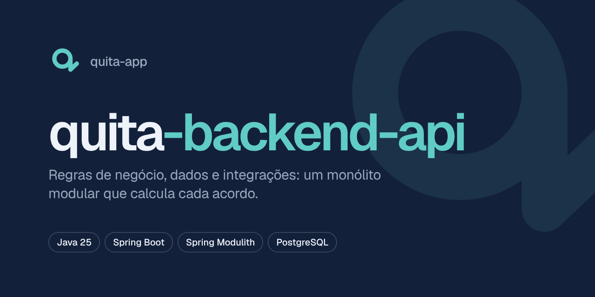
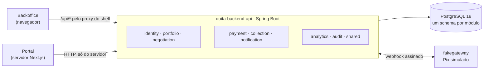

<p align="center">
  
</p>

<p align="center">
  <strong>Capítulo 2 · As regras</strong><br />
  A API do Quita: onde mora cada regra de desconto, de Acordo e de pagamento.
</p>

<p align="center">
  
  
  
  
  
</p>

---

## O Quita em uma frase

Uma plataforma B2B de cobrança e renegociação: a **Credora** (uma escola, uma clínica) sobe a lista de quem deve e define até onde aceita negociar; o **Devedor** resolve sozinho pelo celular; o **Operador** cuida só das exceções; o **Gestor** vê quanto recuperou.

## Onde este capítulo entra na história

A Ana deve R$ 1.000,00 de mensalidade para a escola, vencida há 120 dias. A política da escola, para a faixa de 91 a 180 dias de atraso, permite até 25% de desconto à vista e até 10 parcelas. A Ana simula, escolhe 5 parcelas, paga a entrada por Pix e o Acordo fica ativo.

**Cada número dessa história é calculado aqui.** Os fronts mostram, perguntam e confirmam; esta API decide. Ela é a única fonte de verdade sobre dinheiro, estados e permissões, e é por isso que nenhum front faz conta com dinheiro.

| Capítulo | Repositório | Para quem | O que resolve |
| --- | --- | --- | --- |
| 1 · O porquê | [`quita-docs`](https://github.com/quita-app/quita-docs) | Quem quer entender o produto | Problema, regras de negócio, arquitetura e decisões |
| **2 · As regras** 📍 | **`quita-backend-api`** | Todos, por trás das telas | Regras, dados e integrações (você está aqui) |
| 3 · O balcão da Credora | [`quita-backoffice-web`](https://github.com/quita-app/quita-backoffice-web) | Gestor e Operador | Importar, configurar a Política, trabalhar a Fila, acompanhar o Painel |
| 4 · A porta da Ana | [`quita-debtor-portal-web`](https://github.com/quita-app/quita-debtor-portal-web) | Devedor | Ver a Dívida, simular, fechar o Acordo, pagar por Pix |

## O que esta API faz

- **Guarda as Carteiras** de cada Credora, isoladas por tenant: uma Credora nunca enxerga os Devedores de outra.
- **Aplica a Política de negociação** por faixa de atraso: desconto máximo, parcelas e entrada mínima.
- **Conduz o Acordo** por uma máquina de estados: aguardando entrada → ativo → quitado (ou quebrado, se uma Parcela atrasar além da tolerância).
- **Recebe o Pix** de um gateway simulado, por webhook assinado, e concilia o pagamento.
- **Alimenta o Painel** com taxa de recuperação, conversão do autoatendimento e taxa de quebra.

## Como funciona

Um **monólito modular**: um deploy só, com fronteiras de domínio verificadas por teste. Cada módulo tem o próprio schema no banco e só conversa com os outros pela API pública deles ou por eventos.



| Módulo | Responsabilidade |
| --- | --- |
| `identity` | Credoras, usuários do backoffice, sessões e o código de acesso do Devedor |
| `portfolio` | Importação de Carteira, Devedores e Dívidas |
| `negotiation` | Política, Proposta, Acordo e Parcelas |
| `payment` | Cobranças, pagamentos e webhooks do gateway |
| `collection` | Fila de trabalho, reserva do Devedor e Tratativas |
| `notification` | Mensagens de saída (e-mail e SMS simulados) |
| `analytics` | Modelos de leitura do Painel |
| `audit` | Trilha das ações sensíveis |
| `fakegateway` | O provedor de Pix simulado, alcançado só por HTTP |
| `shared` | Núcleo sem regra de negócio (dinheiro, tenant, web, tempo) |

## Comece em 5 minutos

**Você precisa de:** JDK 25 e Docker Desktop aberto.

```bash
git clone https://github.com/quita-app/quita-backend-api.git
cd quita-backend-api

docker compose up -d                                        # PostgreSQL 18 local, porta 5432
./mvnw spring-boot:run -Dspring-boot.run.profiles=local     # API em http://localhost:8080 (migra o banco na subida)
```

Em outro terminal:

```bash
curl localhost:8080/actuator/health
# {"status":"UP","components":{"db":{"status":"UP"}, ...}}
```

`UP` com `db` dentro quer dizer: a API está de pé **e** o banco respondeu. No perfil `local`, o contrato da API fica em `http://localhost:8080/swagger-ui.html`.

## Comandos do dia a dia

| Para | Comando |
| --- | --- |
| Subir o banco local | `docker compose up -d` |
| Rodar a API | `./mvnw spring-boot:run -Dspring-boot.run.profiles=local` |
| Testes (precisa do Docker) | `./mvnw verify` |
| Só o teste de fronteiras dos módulos | `./mvnw test -Dtest=ModularityTests` |
| Gerar o contrato `openapi.json` | com a API rodando: `curl -s localhost:8080/v3/api-docs -o openapi.json` |
| Zerar o banco local | `docker compose down -v && docker compose up -d` |

## Configuração

Um artefato só, configurado por ambiente. Segredo nunca entra no repositório.

| Onde | De onde vêm os valores |
| --- | --- |
| Sua máquina | `src/main/resources/application-local.yaml` (o banco do `compose.yaml`) |
| Ambiente publicado | Variáveis de ambiente do Render |

Todas as variáveis estão documentadas, com comentário, em [`.env.example`](.env.example).

## Estrutura

```
src/main/java/com/quita/
  <módulo>/                    um pacote por módulo (a raiz é a API pública dele)
    internal/                  o interior do módulo: invisível para os outros
  shared/                      núcleo sem regra de negócio
src/main/resources/
  application.yaml             configuração padrão (a da nuvem)
  application-local.yaml       só o que muda na sua máquina
  db/migration/<módulo>/       migrações Flyway, uma pasta por módulo
src/test/java/com/quita/
  ModularityTests.java         falha se um módulo mexer no interior de outro
openapi.json                   contrato da API, versionado (os fronts geram os tipos a partir dele)
compose.yaml                   PostgreSQL local, na mesma versão da nuvem
```

## Decisões que moldam este repositório

| Decisão | Por quê | ADR |
| --- | --- | --- |
| Monólito modular, não microsserviços | Fronteiras de domínio sem o custo de operar vários serviços | [0003](https://github.com/quita-app/quita-docs/blob/main/docs/adr/0003-modular-monolith.md) |
| Spring MVC com virtual threads | Muita espera por banco, pouca memória no plano gratuito | [0009](https://github.com/quita-app/quita-docs/blob/main/docs/adr/0009-spring-mvc-virtual-threads.md) |
| Sem chave estrangeira entre schemas | Cada módulo pode virar serviço sem migrar dados | [0008](https://github.com/quita-app/quita-docs/blob/main/docs/adr/0008-no-cross-schema-foreign-keys.md) |
| Tenant por coluna discriminadora | Um banco só, com isolamento verificado por teste | [0006](https://github.com/quita-app/quita-docs/blob/main/docs/adr/0006-tenant-discriminator-column.md) |
| Contrato REST gerado do código | Os fronts geram os tipos a partir do `openapi.json` | [0005](https://github.com/quita-app/quita-docs/blob/main/docs/adr/0005-rest-openapi-generated-clients.md) |

## Status

O Quita é construído em fatias verticais. O [roadmap](https://github.com/quita-app/quita-docs/blob/main/docs/roadmap.md) tem as 14 do MVP.

- [x] **F01 · Walking skeleton, parte local:** health check com banco, schemas por migração, módulos com fronteira verificada, teste com PostgreSQL real, contrato versionado.
- [ ] **F01 · Publicação:** Dockerfile, CI, migração antes do deploy, Render + Neon.
- [ ] **F02 em diante:** login do backoffice, Credoras, importação de Carteira, Política, Acordo, Pix…

## Leia também

- [Glossário](https://github.com/quita-app/quita-docs/blob/main/GLOSSARY.md): o vocabulário do domínio e o nome de cada termo no código.
- [LLD da API](https://github.com/quita-app/quita-docs/blob/main/docs/lld/api.md): módulos, regras, máquinas de estado e contrato.
- [LLD do banco](https://github.com/quita-app/quita-docs/blob/main/docs/lld/database.md): schemas, convenções e migrações.

<p align="center"><sub>Quita · cobrança que baixa a tensão</sub></p>
